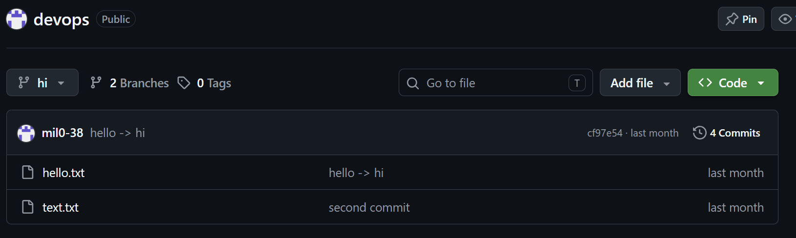

# DevOps 결과 보고서

## 1. GitHub 리포지터리
- 리포지터리: https://github.com/mil0-38/devops (Public)
- 캡처: 리포지터리 메인 화면 (공개 상태, 주차별 폴더 확인 가능)



## 2. 주차별 README
| 주차 | 내용 | 파일 |
|---|---|---|
| 4주차 | 자동화(find, grep, 파이프, 프로세스, 백업), Git 협업, 네트워크 | [week04/README.md](week04/README.md) |
| 5주차 | Docker 기본 명령, Issue 기반 작업 | [week05/README.md](week05/README.md) |
| 7주차 | 도커 컴포즈, scale, 볼륨, .env | [week07/README.md](week07/README.md) |

## 3. Issue에서 Merge까지
PPT 1장: `Issue_to_Merge.pptx`

## 4. web=3을 항상 유지하는 방법 (07 도커 컴포즈 48쪽)

### 4-1. 문제
`docker stop guestbook-web-2`로 직접 멈춘 컨테이너는 `restart: unless-stopped`로 되살아나지 않는다. 사람이 `docker compose up -d --scale web=3`을 다시 입력해야 3개가 된다.

### 4-2. 방법
사람이 하던 확인과 복구를 셸 스크립트(`guestbook/keep-web-3.sh`)가 반복한다.

```text
의사코드
DESIRED = 3
반복(영원히):
    RUNNING = 실행 중인 web 컨테이너 수
    만약 RUNNING != DESIRED:
        docker compose up -d --scale web=DESIRED
    10초 대기
```

```bash
cd ~/devops/work/guestbook
./keep-web-3.sh 3 10                                      # 포그라운드 (종료: Ctrl+C)
nohup ./keep-web-3.sh 3 10 >> keep-web-3.log 2>&1 &       # 백그라운드 (종료: kill <PID>)
```

확인 순서:
1. `docker compose up -d --scale web=3` 으로 3개 실행
2. `docker stop guestbook-web-2`
3. 최대 10초 후 `docker compose ps`에서 web 3개 확인

`up`은 멈춘 컨테이너를 다시 시작하거나 없는 컨테이너를 새로 만들어 개수를 맞추므로, `docker rm -f`로 지운 경우도 복구된다. 기존의 `restart: unless-stopped`는 비정상 종료 시 자동 재시작을 맡고, 스크립트는 그 외의 경우를 맡는다.

### 4-3. 장점
- 수업에서 배운 셸 스크립트(변수, 조건, 반복), `docker compose`, 프로세스 관리만으로 구현된다.
- 직접 멈춘 경우와 삭제한 경우도 복구된다.
- 개수와 간격을 인자로 바꿀 수 있다.
- 복구 시각이 로그로 남는다.

### 4-4. 단점 및 한계
- 점검 간격(10초) 동안은 3개가 아닐 수 있고, 그 사이 502 오류가 날 수 있다.
- 컴퓨터 한 대 안에서만 동작한다. 서버 자체가 고장 나면 복구할 수 없다 (컴포즈의 한계, Kubernetes 영역).
- 스크립트 자신이 종료되면 감시도 끝난다. 재부팅 후에는 다시 실행해야 한다.
- 일부러 `docker compose down`이나 `stop`을 해도 다시 띄운다. 점검할 때는 스크립트를 먼저 종료해야 한다.
- `up --watch`의 rebuild로 컨테이너가 재생성되는 동안 개수가 줄어 스크립트와 겹칠 수 있다.
- "실행 중"만 센다. healthy 여부는 확인하지 않는다.
