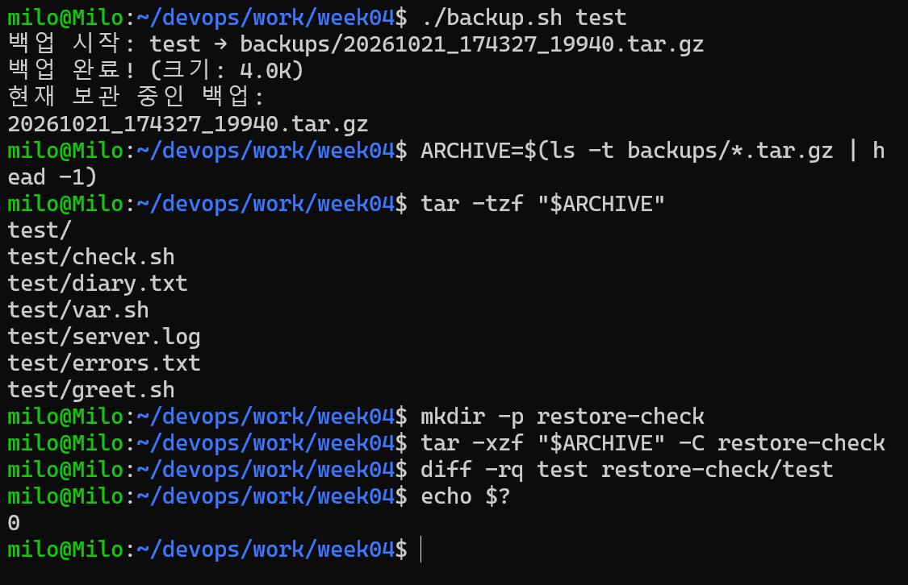
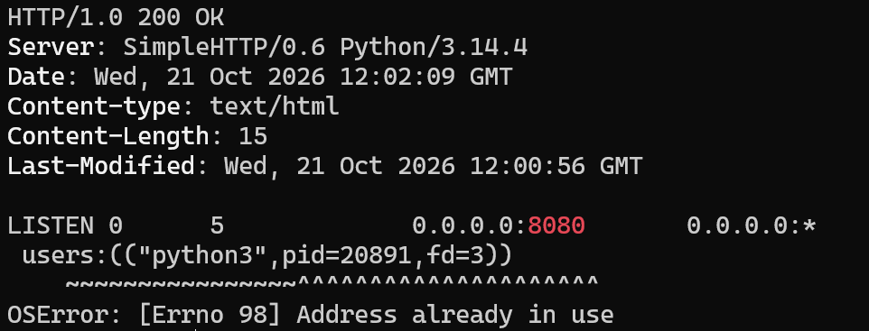

# 4주차 - 자동화와 협업 / 네트워크

## 1. 자동화
| 항목 | 명령어 | 의미 |
|---|---|---|
| 파일 찾기 | `find . -type f -name "*.sh"` | 셸 스크립트 파일 검색 |
| 내용 찾기 | `grep -R -n "exit 1" week03` | 하위 디렉터리까지(-R) 줄 번호(-n)와 함께 검색 |
| 파이프 | `grep ERROR server.log \| wc -l` | 앞 명령의 표준 출력을 뒤 명령의 표준 입력으로 연결 |
| 프로세스 | `sleep 300 &` → `ps aux \| grep sleep` → `kill <PID>` | 백그라운드 실행 후 PID로 종료 (`kill -9`는 최후의 수단) |
| 백업 | `./backup.sh test` | `tar -czf`로 압축, `tar -xzf -C`로 복원, `diff -rq`로 비교 |

- 절대 경로는 `/`부터, 상대 경로는 현재 위치 기준이다. 스크립트의 `cd "$(dirname "$0")"`는 어디서 호출해도 스크립트 위치를 기준으로 실행하기 위함이다.
- `.gitignore`에 `week04/backups/`, `week04/restore-check/`를 추가하여 백업 결과물은 Git으로 관리하지 않는다.



## 2. 협업 (브랜치 → PR → Merge)
```bash
git switch -c feature/backup-log
git add week04/backup.sh
git commit -m "feat: 백업 로그 기록 기능 추가"
git push -u origin feature/backup-log
gh pr create --title "백업 로그 기록 기능 추가" --body "..." --base main
gh pr merge --squash --delete-branch
git switch main && git pull --ff-only
```
- Conflict: 같은 줄을 서로 다르게 수정하면 발생한다. Git이 망가진 것이 아니라 무엇을 남길지 사람이 결정하라는 뜻이다.
- 해결: `<<<<<<<`, `=======`, `>>>>>>>` 줄을 지우고 남길 내용만 편집 → `add` → `commit` → `push` → `gh pr merge`


## 3. 네트워크
| 항목 | 명령어 |
|---|---|
| 내 IP | `ip addr`, `hostname -I`, `curl ifconfig.me`(공인 IP) |
| 연결 확인 | `ping -c 4 8.8.8.8` |
| DNS 조회 | `dig cs.inhatc.ac.kr +short`, `nslookup cs.inhatc.ac.kr` |
| HTTP 확인 | `curl -I http://localhost:8080` |
| LISTEN 포트 | `ss -tlnp \| grep 8080` |

- IP는 장치(건물) 주소, 포트는 그 장치 안의 서비스(호수)를 구분하는 번호이다.
- 웹 서버: `python3 -m http.server 8080` → `http://localhost:8080` 접속
- 같은 포트로 서버를 또 띄우면 `OSError: [Errno 98] Address already in use`(포트 충돌) 발생 → 다른 포트 사용 또는 `ss -tlnp`로 PID 확인 후 `kill <PID>`


