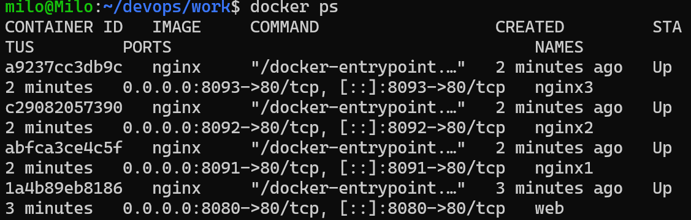
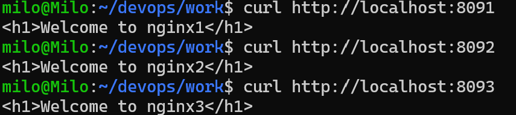

# 5주차 - Docker

## 핵심 개념
- 이미지(붕어빵 틀, 읽기 전용) → `docker run` → 컨테이너(붕어빵, 실행 인스턴스). 컨테이너를 삭제하면 쓰기 계층의 변경 내용도 사라진다.
- 컨테이너는 호스트 OS 커널을 공유하며 namespace(격리), cgroup(자원 제한)를 사용한다.

## 실습 기록
```bash
docker --version
docker run hello-world
docker run -d -p 8080:80 --name web nginx
curl -I http://localhost:8080
docker ps
docker logs web
docker exec -it web bash
docker rm -f web
```
- `-d` 백그라운드, `-p 호스트포트:컨테이너포트` 포트 연결, `--name` 컨테이너 이름
- 호스트 포트 8080 중복 시 `port is already allocated`, 컨테이너 이름 중복 시 `Conflict. The container name ... is already in use`



## 혼자 해보기
nginx1(8091), nginx2(8092), nginx3(8093) 실행 후 `exec`로 `index.html`을 수정하여 구분하고 `curl` 결과를 기록한다.

```text
$ curl http://localhost:8091
<h1>Welcome to nginx1</h1>
$ curl http://localhost:8092
<h1>Welcome to nginx2</h1>
$ curl http://localhost:8093
<h1>Welcome to nginx3</h1>
```



## Issue → Merge 흐름
Issue 작성 → `git switch -c docs/issue-<번호>-docker-start` → 기록 후 commit/push → PR 본문에 `Close #<번호>` → `gh pr merge --squash --delete-branch` → Issue 자동 종료(`CLOSED`) 확인
