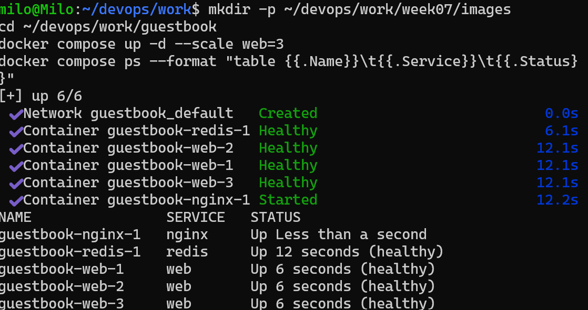

# 7주차 - 도커 컴포즈

## 구성 (guestbook)
`nginx`(8080 공개) → `web` 3개(`expose: 5000`) → `redis`(`.env` 비밀번호, healthcheck, 볼륨 `redis-data`)

## 1. docker compose ps (healthy 포함)


## 2. scale 후 웹 컨테이너 호스트명 변화
`docker compose up -d --scale web=3` 후 `http://localhost:8080`을 새로고침하면 Pod/Host 이름이 바뀐다. `docker ps`의 컨테이너 ID와 비교한다.


## 3. down 후 up vs down -v 후 up
| 명령 | 삭제 대상 | 방명록 글 |
|---|---|---|
| `docker compose down` → `up -d` | 컨테이너, 네트워크 | 유지 (볼륨 `redis-data`가 남음) |
| `docker compose down -v` → `up -d` | 컨테이너, 네트워크, 볼륨 | 사라짐 |

## 4. .env를 Git에 올리지 않는 이유
`.env`에는 Redis 비밀번호 같은 Secret 값이 있다. GitHub에 올리면 공개되고, 파일에서 지워도 Git 이력에 남을 수 있다. 그래서 `.gitignore`에 `.env`를 추가하고, 이름만 알려 주는 `.env.example`만 올린다.

## 제출
```bash
git add work .gitignore
git status        # compose.yaml, nginx.conf, .env.example 포함 / .env 없어야 함
git commit -m "week07: compose + nginx + healthcheck"
git push
git tag week07 && git push origin week07
```
